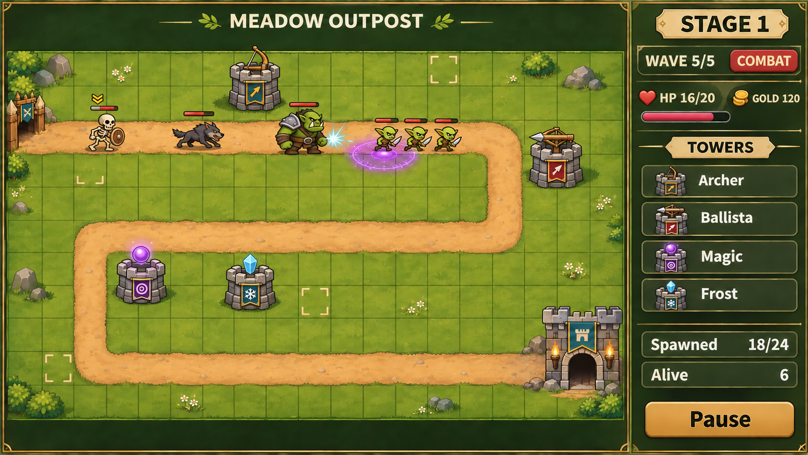
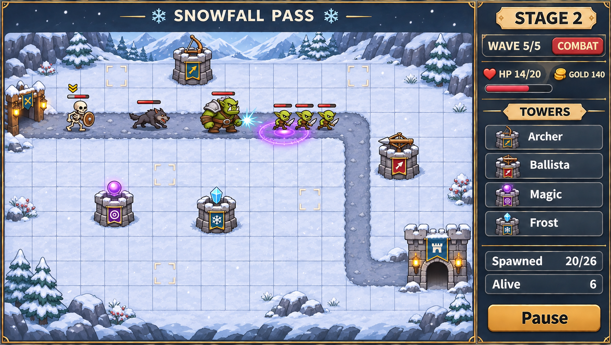
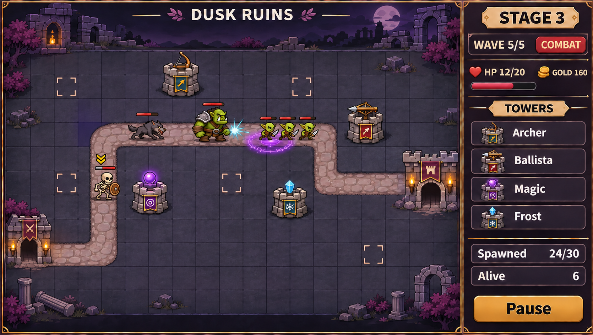

# Ddooby-defence 디자인 초안

> ART-01 · Stage 1~3 전투 화면 시안 · 2026-11-23 · **사용자 선택 완료**: Stage 1 2차(v2)·Stage 2·Stage 3 시각 시안
>
> 선택 범위는 시각 방향(배경·경로 분위기·타워·몬스터·HUD 스타일)이다. 18×10 실제 맵 데이터(waypoint·경로 폭·예약 칸), HUD에 그려진 예시 수치, 구현·QA는 기존대로 **미정/미실행**이다.

## Stage 1 · 초원 전초기지

밝은 황토색 길을 따라 왼쪽 생성 지점에서 오른쪽 아래 성문까지 이동하는 흐름을 한 화면에 담았다. 잔디에는 격자선을 낮은 대비로 깔고 일부 빈 설치 칸에 밝은 모서리 표시를 둔다. 2차 시안은 사용자 피드백을 반영해 1차의 초원 배경과 성문 구도를 바탕으로 타워와 몬스터의 외형을 다듬었다.

## Stage 2 · 눈 내리는 협곡

밝은 눈밭과 회청색 길을 구분하고, 눈송이와 설산은 전투를 가리지 않게 배치한다. 왼쪽에서 시작하는 긴 직선과 두 번의 굽이는 장거리 공격 위치와 군집을 노릴 자리를 비교하기 위한 경로 후보다. 스테이지의 중장형·경량 군집형 강조를 보여주기 위해 오크와 고블린 무리를 직선 구간에 배치했다.

## Stage 3 · 어스름 폐허

달빛과 횃불로 폐허의 야간 분위기를 살리고, 밝은 석판 길과 어두운 설치 칸을 구분한다. 왼쪽 아래에서 시작해 위로 올라갔다가 오른쪽 성문으로 꺾이는 길은 굽이 사이에서 여러 경로 구간을 커버하는 배치를 검토하기 위한 후보다.

## 화면 구성

| 요소 | 시안의 표현 | 구현에 적용할 기준 |
|---|---|---|
| 맵과 설치 칸 | 큰 굽이의 흙길 한 갈래, 잔디 바닥, 설치 가능한 빈 칸의 모서리 표시 | 정사각형 논리 타일 18열×10행. 경로·생성 지점·기지·예약 칸·점유 칸은 설치 불가. 실제 waypoint, 경로 폭, 예약 칸은 맵 데이터에서 결정한다. |
| 성문 | 청록 깃발과 어두운 문을 단 석조 관문. 흙길의 끝을 문 입구까지 연결 | 적의 경로 종점과 기지 피해가 발생하는 위치를 관문에 맞춘다. 현재 기지 HP는 우측 HUD에 표시한다. |
| 우측 HUD | 스테이지, 웨이브, 전투 상태, 기지 HP와 골드, 타워 4종, 생성 진행, 생존 적 수, 일시정지 | 맵과 분리된 우측 영역에 표시한다. 타워 선택·설치와 타워 상세, 준비·일시정지·결과 등 다른 화면 상태는 SPEC을 따른다. |

세 그림은 16:9 기준의 전투 중 화면 후보다. 그림 속 격자 수는 18×10 논리 격자와 차이가 있다. 지도 좌표와 설치 판정은 실제 데이터로 정한다. 그림에 들어간 영문과 골드·HP·적 수는 시안용 예시이며, UI 언어와 콘텐츠 수치는 각각 결정한다.

## 타워와 몬스터

네 타워는 성가퀴가 있는 낮은 회색 석조 몸체를 공유한다. 종류는 상단 장치의 모양과 전면 깃발의 문양·색으로 구분한다. 우측 HUD 아이콘에도 같은 장치와 문양을 쓴다.

| 타워 | 상단 장치와 전면 문양 | 전투 표현 |
|---|---|---|
| 궁수형 | 세로로 선 활과 금색 화살 문양 | 가는 화살로 빠른 단일 공격 표현 |
| 발리스타형 | 가로로 놓인 쇠뇌와 붉은 깃발의 굵은 볼트 문양 | 굵은 볼트로 강한 단일 공격 표현 |
| 마법형 | 떠 있는 보라색 구체와 원형 마법 문양 | 고정 충돌 지점 중심의 원형 폭발 |
| 서리형 | 하늘색 얼음 결정과 눈송이 문양 | 청백색 단일 명중과 서리 둔화 효과 |

타워의 점유는 종류와 레벨에 관계없이 1×1 타일이다. Lv1~4 외형은 공통 몸체를 바탕으로 상단 장치와 장식에 단계별 변화를 주는 방향이다.

| 몬스터 | 시안의 식별 요소 |
|---|---|
| 일반형 | 둥근 방패를 든 뼈색 해골 |
| 고속형 | 몸이 낮고 앞으로 뻗은 늑대 |
| 중장형 | 넓은 어깨, 철제 견갑과 드러난 엄니의 오크 |
| 경량 군집형 | 뾰족한 귀와 짧은 단검을 든 작은 고블린 무리 |

보조 특성 표식은 체력 바와 함께 보여주되 몸체의 실루엣을 살린다. 그림의 꺾쇠 표식은 위치와 크기 후보이며 세 특성의 표식 체계는 후속 디자인에서 정한다. Stage 1의 5개 웨이브 전체에 네 적 유형과 세 특성이 등장한다.

## 앱 아이콘 (ART-02, 사용자 선택 2026-11-26)

C안 **성채 방패**: 금테 청록 방패에 상아색 성탑, 배경 `#162C37`. 시작 화면은 같은 문장을 짙은 남색 가운데에. 기록 `.codex-out/ART-02-image.md`.

## 검토 자료

- 제품 규칙과 미정 항목. [SPEC.md](../SPEC.md)
- 화면 배치와 입력 경계. [PLAN.md §6](PLAN.md#6-ui시각적-경계)
- 초기 시안 범위와 승인 조건. [TASKS.md §2](TASKS.md#2-디자인-시안-v01-문서-이후)
- 이미지 생성 이력과 검토 기록. [ART-01-image.md](../.codex-out/ART-01-image.md)
